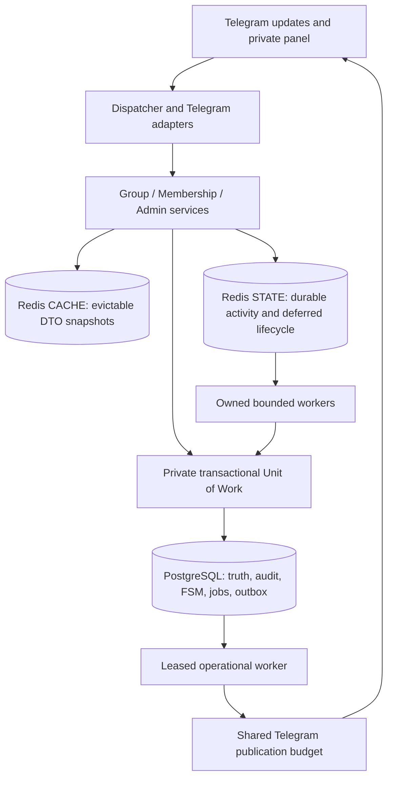

# Administration, membership and cache architecture

October 17 follow-up: the actual Couplyo UI uses reply category/form menus and
native inline controls for cleanup, directories, watch switches and confirmations.
The previous conversion of all inline controls to reply text has been removed.
Download settings expose the live per-user and
default per-group requests/minute limits, plus the existing per-group override.
They also expose independent user/group quota switches and optional gap switches
with editable seconds. Main and delegated bot admins consume no download rate
slots. See [the current request-limit policy](REQUEST_LIMITS.md).
The [October 17 UI follow-up](ADMIN_UI_20261017.md) removes repeated inline
management links, keeps Cancel only in the root reply menu, and uses a fixed
label with a checked/empty state icon for each download switch. Data utilities
remain available in their own submenu. Backup now exports the complete
PostgreSQL database as a custom `.dump`, including every bot account and table;
legacy JSON import remains available separately from native full restoration.
Revision 13 adds persistent rolling user windows and adopts legacy timestamps.
Read the [security review and verification scope](SECURITY_REVIEW.md).

The current source-based implementation is described in [Couplyo parity](COUPLYO_PARITY.md).
It supersedes the earlier revision-10 observed-only scope below: the category-based
reply-keyboard panel, full resumable roster crawl, channel management, reminders,
reports and guarded data operations are implemented through revision 12. The historical
verification figures at the end of this document describe revision 10 only.
The [October 16 verification follow-up](COUPLYO_TELEGRAM_VERIFICATION.md) adds exact
applicable source copy, normalized channels/watch storage, daily history, fixed
report windows and protection against resurrecting purged accounts.

October 16, 2026 implementation of the supplied local `docss/` reference. This is
the downloader-domain continuation of [reference mapping](REFERENCE_MAPPING.md).
The private Persian reference bundle stays on the workstation and is ignored by
Git. Executable code, English documentation and generated schema are committed.

## Entry points and permissions

Set the numeric `MAIN_ADMIN_ID` in `.env`, restart Python, then send `/admin` to
the bot **in private**. No web server, additional public port or administrator
password is introduced. An empty root ID leaves main-administrator controls unavailable; existing delegated roles still require fresh SQL authorization.
YouTube is available to everyone; delegated administration and group administrator
roles do not change installation privileges.

| Operation | Main administrator | Delegated administrator |
| --- | --- | --- |
| Statistics, seven-day lifecycle report, users/groups/search and delivery history | Yes | Yes |
| Observed human members, group details and health checks | Yes | Yes |
| Cache availability and pending jobs | Yes | Yes |
| Grant/revoke delegated roles; ban/unban download users | Yes | No |
| Global download maintenance switch; lifecycle notifications | Yes | No |
| Per-group rolling link quota | Yes | No |
| User/group rate switches, minute quotas and request gaps | Yes | No |
| Full application database reset across bot IDs, with explicit confirmation and shutdown | Yes | No |
| Broadcast or forward to private subscribers / eligible groups | Yes | No |
| Leave a group; cancel pending administration jobs | Yes | No |
| Bounded CSV export and user-name import | Yes | No |

Buttons are bound to their owner and private chat. Role/ban checks read SQL on
every privileged operation; a cached profile cannot authorize a revoked manager.
Buttons with a premium icon use plain text labels, without a second Unicode
decoration. Emoji-only navigation keeps one Unicode icon so its text stays
nonempty. If Telegram rejects premium icons, the original labels are restored.
Private reply menus persist visible-label aliases in the existing owner/chat
conversation record. Inline controls retain their owner-scoped callback payloads;
they are never translated into typed reply actions. Confirmation tokens remain
in SQL, so they survive restart and cannot be consumed twice.
The configured root cannot be revoked or banned through the panel. Prompts are
SQL records tied to owner and outgoing reply message; unrelated replies continue
through normal routing. Administrative text containing a provider link is consumed
as administrative input and does not start an accidental download.

Broadcast, forwarding, health and leave operations require separate, single-use
confirmation. Tokens expire after 20 minutes, survive coordinator restart and
cannot be consumed by another user. Database audit records identify actor, action,
target and safe counts; raw broadcast text is stored only in the operational
payload needed for delivery, not copied to audit/logs.

## Couplyo keyboard behavior

| Screen | Keyboard and interaction |
| --- | --- |
| Main panel and administrator, messaging, group, channel, data, cleanup and download categories | Reply keyboard with source back/cancel hierarchy |
| Forced-join points, global storage kinds, schedules and text-input forms | Reply controls; canonical labels survive premium-icon rendering |
| Group/member directories, daily history and download history | Inline filters/navigation; edits reuse the current message |
| Group directory refresh | Re-read the SQL snapshot; never starts a health sweep |
| Per-group watch list, kind switches and removal confirmation | Native inline controls carrying the watch ID |
| Filtered cleanup | Inline entity picker, independent checkbox choices, live counts, defaults/all, explicit confirmation, back and close |
| Bot/deleted-account purge and other operation confirmations | Native inline confirm/cancel; text alone cannot execute the action |

Cleanup adopts the Couplyo interaction and shared wording for fields present in
the downloader: start history, group history, account kind, bot administration,
members and known owner. Matching/couple/profile attributes are absent because
this product does not store those features. Downloader quota, CSV and cache tools
remain available in their existing categories. Deletion retains the existing
protected-admin/active-member and inactive-group constraints and 1,000-row cap.
No database migration or new service is required.

Workstation verification on October 17: the complete suite passed 2,447 tests
with no skips, using dedicated PostgreSQL 17 and Redis containers. Telegram TL
objects and callback dispatch were exercised locally; RPC delivery was simulated.
Ruff checks and the migration/schema-reference check also passed.

Private broadcasts only target users who actually used private `/start`, excluding
banned/blocked accounts. Receiving a group message, downloading without `/start`
or importing a CSV never grants subscriber status. Group publications exclude
removed, migrated and explicitly write-restricted groups. Text broadcast supports
an `استثنا: -123,-456` first line to exclude target IDs. Forwarding retains the
source private message; Telegram must still allow forwarding/access to that source.

CSV export uses keyset pages of at most 500 rows. Import accepts at most 500 rows
and 1 MiB with `user_id,username,first_name,last_name` columns, rejects ambiguous
headers/rows and only fills missing names. It cannot import administrator roles,
bans, `/start` evidence or group membership. Exported CSV is a bounded management
report, **not a PostgreSQL backup**. Formula-like string cells are escaped.

## Ownership and asynchronous execution

`bot/handlers/admin.py` owns Telegram input, `bot/texts/admin.py` copy and
`bot/keyboards/admin.py` callbacks. `services/admin.py` owns policy, confirmation
and transactions. SQL belongs to `repositories/postgres/admin.py` and
`outbox.py`. Immutable views live in `schemas/admin.py`; schema owners are
`db/postgres/models/administration.py`, `membership.py` and `peer.py`.
`bot/operations.py` translates Telegram RPC outcomes; business services never
import Telethon. The composition root owns all pools, sessions and workers through
one `AsyncExitStack`; shutdown cancels and awaits the workers before dependencies
close. Network/database waits use async APIs. Pure parsing remains synchronous.

## Group lifecycle and human membership

The existing [group update matrix](GROUPS.md) remains in force, augmented with:

- A lock per active chat and a three-attempt, 1.5-second settle check after a
  provisional add. Definite newer admin standing defeats stale demotion evidence.
  UNKNOWN never means GONE; send permission remains separate from membership.
- Bot-scoped saved peer addresses for cold-session recovery, using only real
  access hashes. Recovering an address does not prove current group membership.
- Owner/admin-ID/member-count snapshots, refreshed with bounded metadata work.
  These fields are descriptive; they do not grant installation authorization and
  a bounded administrator snapshot is not a complete historical roster.
- First-known adder, earliest add date and old audit survive re-add/migration;
  `removed_at` changes on an actual departure, and demotion/removal clears
  `admin_since`. Migration transfers quota settings and retires the old identity.
- Actual non-bot, non-deleted Telegram `User` entities create human membership
  records. Negative senders, channels, anonymous senders and incomplete user
  objects do not. Text and media messages both count; message content is not saved
  by the membership subsystem. No private `/start` is required for downloads.
- Unique `(bot, chat, event_key)` ledger entries make repeated activity idempotent.
  Raw participant and complementary service join/leave versions and timestamps reject stale state changes; a
  same-second ordinary message cannot revive a recorded leave. A genuinely newer
  message can provide new presence evidence in an active group.
- New memberships and joins/leaves commit immediately. Known-active message
  activity can be batched through STATE. Ordinary activity never changes the bot's
  recorded membership or proves that every group member has been discovered.

Membership history stays under its original group identity during migration;
observations populate the new identity without inventing current members. Private
profile updates are separate from group membership and from the `/start` flag.
Revision 11 adds a separate resumable full-roster crawl for eligible administrator
groups. There is no startup dialog scan or claim to recover updates/members that
Telegram never delivers.

## CACHE / STATE / OPS contracts

| Family | Storage and contract |
| --- | --- |
| Group/user/setting snapshots | CACHE, `cache:v3:<bot>:<kind>:<identity>`, strict versioned DTOs and negative entries; default TTL 300 seconds |
| Existing Telegram media cache | Existing independent file-cache repository, verified references and SQL fallback |
| Membership activity | STATE streams, `state:v1:<bot>:membership:<shard>`, 16 shards, consumer groups, up to 2,000 records per shard batch |
| Deferred lifecycle writes | Separate STATE stream family; typed bot/group events, replayed through the same SQL policy |
| FSM, menus and interactive ownership | Existing non-expiring PostgreSQL records; disposable bounded process cache |
| Administrative OPS | PostgreSQL confirmation, jobs and outbox tables, scoped leases and durable progress |
| Publication pacing | Shared per-bot STATE budget and FloodWait pause; bounded process fallback when unavailable |

SQL commits precede cache writes/invalidation. Invalid payloads and WRONGTYPE are
single-key misses. Infrastructure failure uses SQL and does not repopulate during
the same failed read. Bounded dirty-key/generation tracking prevents a failed
write or local stale in-flight read from poisoning subsequent reads; group
revisions prevent older writers replacing newer cached snapshots. Positive TTLs
bound staleness across other processes, restart and cache repair failures. Sensitive
roles, bans, maintenance and quota grants always use fresh SQL. Startup performs
no cache flush or mass preload. There is no cache administration operation that
can erase FSM, quotas or job state.

STATE uses AOF (`appendfsync everysec`), `noeviction` and its own Docker volume.
Stream append has a 100,000-record cap **per shard** and never trims uncommitted
entries. Full/unavailable STATE falls back to immediate SQL. The consumer reclaims
unacknowledged work after 120 seconds and acknowledges/deletes it only after the
SQL batch commits. A crash after commit but before ACK safely replays the unique
event ledger. Invalid entries must be written to a bounded seven-day quarantine
before ACK; failure to quarantine leaves the original pending.

Flush defaults to 45 seconds. AOF everysec can lose a recent unflushed interval
on host failure; SQL is authoritative only for committed batches. This is not
lossless event sourcing. With no configured STATE endpoint, activity writes go
directly to SQL and lifecycle storage failures propagate instead of disappearing
into the evictable cache. Simultaneous SQL and STATE failure cannot durably accept
new activity. Administrative jobs/outbox are SQL-backed even in this mode.

## Jobs, leases and retry

Enumeration walks keyset pages of 50 and commits target outbox entries together
with its cursor. Jobs use a 60-second lease and `SKIP LOCKED`; outbox workers claim
four effects at a time with distinct ownership. Delivery has a 15-second timeout.
Finishing an effect and updating its job counters share a transaction and require
the same lease owner. Expired claims are recoverable after restart. Reconfirmation
or competing workers cannot create duplicate job/target identities.

Each message/forward persists one Telegram `random_id` and reuses it on retry,
including custom-emoji fallback. Explicit FloodWait persists a due time and shared
pause; other transient failures back off up to six attempts. Permanent forbidden,
blocked and deleted-recipient outcomes are recorded and classified; UNKNOWN health
is a failed check, never a removal. A Telegram-confirmed leave followed by failed
SQL persistence retries the local removal rather than forgetting it. Recent actual
group standing transitions can enqueue an administrator notification in the same
transaction as their audit.

The panel exposes queued/running/done/failed/cancelled and total/success/failure/
skipped counters. Cancellation stops queued effects and rechecks claimed effects;
it cannot retract an RPC already in flight. Permission is rechecked before job
enumeration and execution. Only one coordinator per bot is supported, with the
existing PostgreSQL account lock. SQL and Telegram are separate systems: stable
random IDs reduce duplicate sends but do not establish unlimited exactly-once
delivery. No 500,000-group or live 1,000-origin-requests/s guarantee follows.

## Upgrade

Revision **10** adds eight domain tables and user/group columns without replacing
old primary keys or migration history. All existing media/history/menu/session
paths remain valid. Historical users have `account_kind=unknown` until verified;
an old true `/start` flag is preserved, but a missing historical start date is not
fabricated. The stack retains native asyncpg/frozen dataclasses/SQL FSM rather than
adding a second ORM or replacing the existing database. These are explicit backend
adaptations of the reference contracts. Couple/crush/VIP tables remain outside
the downloader domain; revision 11 implements the separately requested roster.

Stop the old Python receiver, create and verify a restorable PostgreSQL backup,
then use the [operational commands](OPERATIONS.md#administration-upgrade-revision-10).
Do not execute the empty-schema SQL snapshot against production or delete volumes.

## Verification boundary

Tests exercise real isolated PostgreSQL 17 and Redis 7.4 on the workstation.
Coverage includes migration 9-to-10 preservation/concurrent migration, duplicate
membership events, stale ordering, commit-before-ACK recovery, malformed records,
Redis outage, cache write failure/repair, cross-bot isolation, fresh authorization,
confirmation races, exclusions, durable job cursor/lease recovery, cancellation,
CSV restrictions and stable forward/message IDs. Telegram adapters use simulated
RPCs, including premium fallback and health/removal errors. Production deployment,
live group updates and backup restoration were not exercised in this change.

Final workstation validation: **1,472 tests passed, zero skips/failures**, with
real isolated PostgreSQL 17 and Redis 7.4 (96.52 seconds). Ten existing Windows
curl-cffi selector warnings remain. Ruff lint/format passed for 288 Python files;
the exported schema matches all ten revisions. A rebuilt wheel passed isolated
imports of the new modules and excluded private environment/session/runtime data.
An isolated Compose `redis-state` started healthy with AOF/everysec/noeviction and
retained its test key through a graceful container restart. No production data,
Telegram account session or unrelated Docker application was modified.
