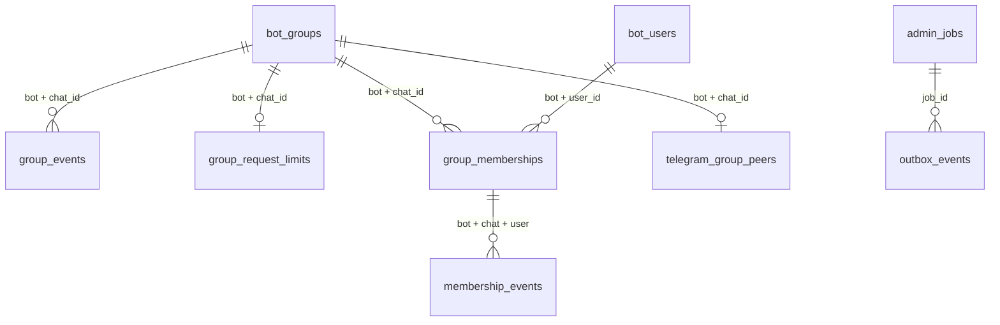

# Database ownership and schema

This document describes the downloader repository, reviewed against the October
15, 2026 Couplyo porting reference supplied in `docss`. Couplyo's 25-table SQL
snapshot belongs to a different product. This application owns **30 domain tables
and one migration ledger**, uses native asyncpg and applies revisions 1–13.
Revision 10 implements administration; revision 11 adds the actual source's
[resumable member crawling and administration flow](COUPLYO_PARITY.md).
Revision 12 adds source-shaped `channels`, `group_watches`, immutable `daily_stats`,
and a downloader safety table, `user_account_tombstones`. It preserves existing
physical names, bot scoping and asyncpg; the SQL schema is not byte-identical to
the single-bot reference. See [the follow-up evidence](COUPLYO_TELEGRAM_VERIFICATION.md).

Revision 13 adds `download_request_windows`, keyed by bot/user/stage with bounded
timestamp arrays, and adopts existing inspection/download cooldown timestamps.
The old `request_limits` table/history and revisions 1–12 remain unchanged.
`app_settings.user_links_per_minute` and `group_links_per_minute` (setting keys,
not columns) supply fresh admission configuration; group-specific overrides
remain on `bot_groups.links_per_minute`.
The same `app_settings` now holds independent quota/gap enable flags and gap
seconds; existing timestamp arrays retain the latest accepted time for gaps up
to one hour. Storage is bounded at 1000 timestamps even with quotas off. The
[administrator exemption and rate controls](REQUEST_LIMITS.md) require no schema
revision beyond 13 and do not erase existing request history.

The [October 17 group-data audit](GROUP_DATA_PARITY_20261017.md) checks applicable
Couplyo group, membership and roster fields against the installed schema, with
populated-data migration reruns. Its ingestion fixes add no schema revision.

## Physical layout and ownership

The root-only [full application reset](DATABASE_RESET.md) empties the model
registry's 30 domain tables across bot IDs without dropping definitions or the
migration ledger. A consumed `admin_requests.database_reset_pending` action
temporarily records Redis cleanup recovery; the record is removed on completion,
leaving every domain table empty. It is an action value, not a new column/table.

```text
db/postgres/base.py          Immutable executable table definition
db/postgres/models/         Table definitions and lifecycle constraint SQL
db/postgres/migrations.py    Ordered additive revisions
db/postgres/engine.py        Async pool and serialized migration application
db/postgres/schema.py        Ledger definition and offline reference exporter
db/redis/pool.py             Optional bounded cache pool
schemas/                    Framework-independent domain snapshots
repositories/interfaces/    Storage and delivery protocols
repositories/postgres/      SQL queries and private transaction ownership
repositories/redis/         Cache serialization and SQL-first cache facade
services/                   Domain coordination, admission and cleanup policy
container.py                Construction, injection and resource lifetime
```

PostgreSQL is authoritative. Each `PostgresUnitOfWork` acquires a private connection,
opens a transaction, binds its repositories, commits on success and rolls back on
exception or cancellation. It always releases the connection. No transaction spans
provider extraction or Telegram publication. A session advisory lock permits one
coordinator per bot; separate bot accounts can share the database.

All timestamp columns use `TIMESTAMPTZ`; Python lifecycle values are timezone-aware.
Telegram identities use `BIGINT`, message IDs use `INTEGER`, serialized Telegram
references use `BYTEA`, and structured metadata uses `JSONB`. An absent permission
is represented by nullable standing, not a fabricated negative result.

## Table dictionary

In this table, `bot` abbreviates `telegram_account_id`. Key order is the actual
primary-key order. The declared group, membership, peer and outbox/job relationships are foreign keys;
the other references are application identities and must not be mistaken for
SQL-enforced relationships.

| Table | Primary key | Stored data and lifecycle |
| --- | --- | --- |
| `media_files` | site, content_id, quality, bot | Telegram document ID/access hash/reference, origin peer/message, size and verification flags. Reusable file anchors; only the matching deleted origin is invalidated. |
| `site_accounts` | generated id; unique site, label | Account label, environment-variable **name**, subscription/priority, enabled/expiry/cooldown. Shared installation configuration; credential values remain in the environment. |
| `request_limits` | bot, user_id, scope | Last admitted operation timestamp. Atomic admission remains SQL-authoritative across restarts. |
| `user_link_history` | bot, user_id, url_hash | Submitted/canonical URL, resolved identity/status, counts and first/last observation. No provider cookies or signed media sources. |
| `user_media_history` | bot, user_id, site, content_id, quality | Delivery count, method and first/last successful delivery timestamps. File expiry preserves history. |
| `media_catalog` | bot, site, content_id | Durable public metadata and quality snapshots; authorization and signed transport URLs are excluded. |
| `media_aliases` | bot, alias | Stable submitted alias to provider/content identity. Written atomically with its catalog entry. |
| `bot_users` | bot, user_id | Names, account kind, roles/ban/block status, first/last observation, first private start time/source/chat and actual group-message `last_active_at`. Group requests do not grant private subscriber status. |
| `bot_conversations` | bot, user_id, chat_id | FSM state, operation-owned JSON data and revision. No arbitrary TTL; interrupted operations are recovered at startup. |
| `download_menus` | bot, token | Owning user/chat, original submitted message ID and safe media snapshot. Owner and chat are checked on every callback. |
| `bot_groups` | bot, chat_id | Verified group kind, title/username, nullable active/admin/send standing, first adder and lifecycle timestamps, ordering cursors and migration destination. Negative chat-ID check. |
| `group_events` | generated id; unique bot, chat_id, event_key | Immutable lifecycle audit, actor, occurrence/receipt timestamps, previous/resulting standing and applied/stale flag. FK to the same bot/group. |
| `group_request_limits` | bot, chat_id | Recent accepted timestamps for a rolling 60-second group quota. FK to the same bot/group. |
| `file_message_expiry` | bot, chat_id, message_id | Serialized peer, original 30-second deadline, retry time/attempts and completion timestamp. Only confirmed user-facing file sends; completion tombstones live two days. |
| `group_memberships` | generated id; unique bot, chat_id, user_id | Observed human presence, state ordering, last activity and exact message count; composite group/user foreign keys. |
| `membership_events` | bot, chat_id, event_key | Unique processed message/join/leave ledger and nullable administrator eligibility observed at receipt; no message contents; composite membership FK. |
| `channels` | generated id; unique bot, channel_telegram_id | Shared destination with independent mandatory/archive/storage flags; one archive and storage destination per bot. |
| `group_watches` | generated id; unique bot, chat_id | Independent observed-group destination, link/title and enabled source media classes. |
| `daily_stats` | bot, stat_date | Sealed Tehran-day first starts, acquisition source, group transitions, eligible active senders and totals. No retroactive invention of pre-instrumentation history. |
| `user_account_tombstones` | bot, user_id | Definitive bot/deleted Telegram evidence, retained after deletion to reject stale STATE, roster, CSV and backup resurrection. Protected administrators are excluded. |
| `app_settings` | bot, key | Versioned installation settings and updated timestamps. |
| `admin_actions` | generated id | Bot, actor, action, target and safe audit details. |
| `admin_requests` | bot, token | Owner-bound prompt/confirmation, reply ID, payload, expiry and single-use timestamp. |
| `admin_jobs` | generated id; unique bot, dedupe_key | Job kind/status, cursor, progress counters, payload, due/lease and error code. |
| `outbox_events` | generated id; unique bot, dedupe_key | Durable target effect, stable Telegram random ID, job FK, status, due/lease and outcome. |
| `telegram_group_peers` | bot, chat_id | Typed raw peer and real access hash; composite group FK; never public UI/logs. |
| `group_roster_crawls` | bot, chat_id | Current run ID, owner lease, due time, pass/filter/offset, coverage counters and explicit stop reason; group FK. |
| `roster_crawl_seen` | bot, chat_id, run_id, user_id | Durable per-run human/skipped deduplication; crawl FK. |
| `membership_departures` | bot, chat_id, user_id | Negative departure timestamp and revision fence; group FK without inventing a human profile. |
| `app_schema_migrations` | version | Applied revision name and UTC timestamp. Installation schema ledger, not bot-scoped application data. |

The original group-audit/quota foreign keys deliberately have no `ON DELETE CASCADE`. Membership/peer relationships declare cascades, but application removal is always a soft transition and never invokes them. Removal and
migration retire group identities while preserving their audit and quota history.
Ordinary lifecycle transitions never hard-delete records. The owner's explicit,
confirmed cleanup can delete eligible inactive records and their declared
dependents; active memberships/groups and installation administrators are protected.



The diagram contains only real database foreign keys. For example, a media
catalog identity is associated with aliases/files/history by application queries;
it does not cascade-delete those rows.

Indexes outside primary/unique keys serve actual query paths:

- `media_files_origin`: bot/serialized origin peer/message cache invalidation.
- `user_link_history_content`: bot/site/content lookup.
- `download_menus_owner`: bot/user/chat/creation time.
- `bot_groups_active`: bot/chat, restricted to active rows.
- `group_events_history`: bot/chat/descending occurrence and audit ID.
- `file_message_expiry_due`: bot/next attempt, unfinished rows only.
- `file_message_expiry_completed`: bot/completion time, completed rows only.

## Migrations and reference SQL

Revision **11**, `couplyo_roster_crawl_and_membership_fences`, adds the three
roster/departure tables, membership revision and weekly counter fields, a message
report index, and additional job/effect kinds. Revisions 1–10 remain unchanged.
The revision sequence is a database sequence; gaps are expected and harmless.

| Revision | Responsibility |
| --- | --- |
| 1 | Adopt/create existing media, account, history, quota and catalog tables |
| 2 | Durable users, conversations and owned quality menus |
| 3 | Nullable streaming capability on media references |
| 4 | Completeness verification, false for legacy references |
| 5 | Nullable video preview verification |
| 6 | Nullable classic faststart verification |
| 7 | Group snapshots, lifecycle audit and rolling group admission |
| 8 | Durable file expiry queue and origin lookup index |
| 9 | Repair first-adder attribution from applied add audit, clear invalid admin dates, enforce admin-date standing constraint |
| 10 | User/group administration fields, observed membership/event ledger, settings, audit, confirmations, durable jobs/outbox and typed peer recovery |

Revision 9 follows migrated group identities with cycle protection and preserves
the earliest applied add/re-add actor that their audit actually knows. It cannot
recover an actor absent from that audit. New re-adds preserve the
first known adder. Every demotion/removal/migration path clears `admin_since`.
Neither the previous revisions nor existing primary keys are replaced.

The migration runner acquires a transaction-scoped advisory lock, applies all
unapplied revisions and records their versions in one transaction. A failure
rolls the upgrade back. Concurrent startup attempts serialize this work.

[Reference SQL](reference/POSTGRES_SCHEMA.sql) is generated offline from those
definitions. It includes ordered DDL and revision data repairs for an **empty
schema**, without ledger stamping or production data. It is a review artifact;
use the migration runner for deployment:

```bash
python scripts/export_schema.py
python scripts/export_schema.py --check
python scripts/migrate.py
```

The export tool loads no `.env` and opens no database/network connection. Tests
verify the reference against the source and build an isolated PostgreSQL schema
from it. This is not a live production-schema inspection.

## Cache, state and jobs

| Data family | Owner and recovery |
| --- | --- |
| File cache | Redis `FileRepository`, namespace `media:<bot>:<runtime-uuid>:` and hashed site/content/quality identity; 24-hour TTL, strict versioned payloads, SQL fallback and invalidation |
| Admission rejections | Redis `request:<bot>:<user>:<scope>:<interval>` and bounded process leases; can reject, never grant without SQL |
| Group/user/setting cache | Versioned positive/negative DTO snapshots, revision-safe writes, TTL and SQL fallback |
| Membership/lifecycle activity | Separate persistent STATE streams, commit-before-ACK, quarantine and SQL fallback |
| Administrative OPS | SQL jobs/outbox, owned confirmation, cursor, lease, due time and progress counters |
| FSM and menus | PostgreSQL; bounded in-process hot menu cache is disposable |
| Metadata single-flight | Bounded process state; provider/catalog lookup reconstructs it |
| File expiry | PostgreSQL queue; service owns deadlines, batching, cache invalidation and retry; Telegram adapter owns peer decoding/RPC/FloodWait translation |
| Interactive transfers | Bounded process tasks; interrupted FSM recovered on restart; uncertain sends are never automatically replayed |
| Provider sessions | Independent provider/account HTTP cookie jars; Telegram SQLite session is separate from Redis and PostgreSQL |

`REDIS_CACHE_URL` selects evictable cache storage; blank uses the existing Redis connection. `REDIS_STATE_PORT`/`REDIS_STATE_URL` select a distinct AOF/noeviction service for recoverable activity, lifecycle retries and shared publication pacing. FSM, quotas, confirmations, OPS and expiry remain SQL-backed. Blank STATE means immediate SQL activity, never use of evictable CACHE as a durable queue. Group/user/setting snapshots use strict versioned envelopes, negative caching and a bounded positive TTL; fresh SQL remains the authority for sensitive decisions. See [cache/recovery details](ADMINISTRATION.md#cache--state--ops-contracts).

The expiry queue remains the durable deletion job. Separate revision-10 administrative jobs/outbox implement confirmed broadcasts, forwarding, health checks, leave operations and transactional lifecycle notifications. Direct file publication and SQL
persistence remain separate systems; exactly-once cross-system delivery is not
claimed. Original links, status/quality messages and storage-channel copies are
outside the file-deletion queue.

## Upgrade and recovery

Stop the old receiver, back up PostgreSQL and the account-scoped Telegram session,
verify the restore procedure, pull the new commit, reinstall the editable package
and run `python tools/setup_services.py` and `python scripts/migrate.py` before `python main.py`. Setup now configures a third endpoint for persistent Redis STATE; existing database/cache ports and passwords are preserved. Set `MAIN_ADMIN_ID` for panel access. No new Python dependency or provider credential is required. See the [revision-10 upgrade runbook](OPERATIONS.md#administration-upgrade-revision-10). Existing startup also applies the same idempotent migration chain.

This project has forward migrations only. Do not delete ledger entries or execute
the reference snapshot to downgrade an existing installation. A rollback requiring
old data/constraints needs the tested pre-upgrade backup and matching application
version. Telegram/production access and backup restoration have not been exercised
by the local refactor tests.
