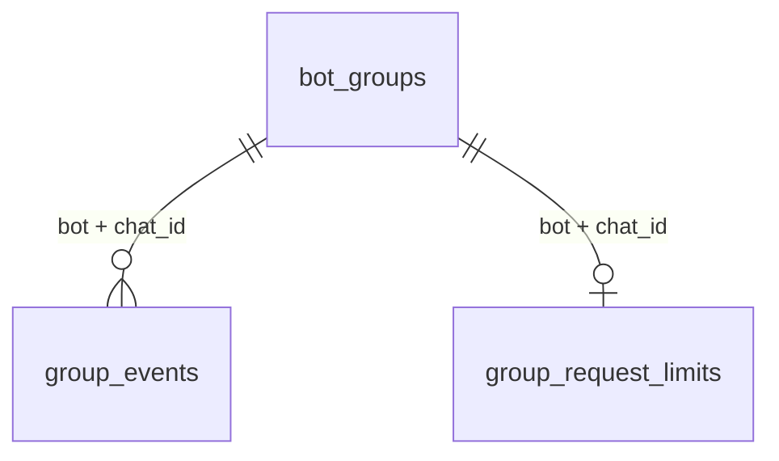

# Database ownership and schema

This document describes the downloader repository, reviewed against the October
15, 2026 Couplyo porting reference supplied in `docss`. Couplyo's 25-table SQL
snapshot belongs to a different product. This application owns **14 domain tables
and one migration ledger**, uses native asyncpg and applies revisions 1–9.

## Physical layout and ownership

```text
db/postgres/base.py          Immutable executable table definition
db/postgres/models/         Table definitions and lifecycle constraint SQL
db/postgres/migrations.py    Ordered additive revisions
db/postgres/engine.py        Async pool and serialized migration application
db/postgres/schema.py        Ledger definition and offline reference exporter
db/redis/pool.py             Optional bounded cache pool
schemas/                    Framework-independent domain snapshots
repositories/interfaces/    Storage and delivery protocols
repositories/postgres/      SQL queries and private transaction ownership
repositories/redis/         Cache serialization and SQL-first cache facade
services/                   Domain coordination, admission and cleanup policy
container.py                Construction, injection and resource lifetime
```

PostgreSQL is authoritative. Each `PostgresUnitOfWork` acquires a private connection,
opens a transaction, binds its repositories, commits on success and rolls back on
exception or cancellation. It always releases the connection. No transaction spans
provider extraction or Telegram publication. A session advisory lock permits one
coordinator per bot; separate bot accounts can share the database.

All timestamp columns use `TIMESTAMPTZ`; Python lifecycle values are timezone-aware.
Telegram identities use `BIGINT`, message IDs use `INTEGER`, serialized Telegram
references use `BYTEA`, and structured metadata uses `JSONB`. An absent permission
is represented by nullable standing, not a fabricated negative result.

## Table dictionary

In this table, `bot` abbreviates `telegram_account_id`. Key order is the actual
primary-key order. Only the two declared group relationships are foreign keys;
the other references are application identities and must not be mistaken for
SQL-enforced relationships.

| Table | Primary key | Stored data and lifecycle |
| --- | --- | --- |
| `media_files` | site, content_id, quality, bot | Telegram document ID/access hash/reference, origin peer/message, size and verification flags. Reusable file anchors; only the matching deleted origin is invalidated. |
| `site_accounts` | generated id; unique site, label | Account label, environment-variable **name**, subscription/priority, enabled/expiry/cooldown. Shared installation configuration; credential values remain in the environment. |
| `request_limits` | bot, user_id, scope | Last admitted operation timestamp. Atomic admission remains SQL-authoritative across restarts. |
| `user_link_history` | bot, user_id, url_hash | Submitted/canonical URL, resolved identity/status, counts and first/last observation. No provider cookies or signed media sources. |
| `user_media_history` | bot, user_id, site, content_id, quality | Delivery count, method and first/last successful delivery timestamps. File expiry preserves history. |
| `media_catalog` | bot, site, content_id | Durable public metadata and quality snapshots; authorization and signed transport URLs are excluded. |
| `media_aliases` | bot, alias | Stable submitted alias to provider/content identity. Written atomically with its catalog entry. |
| `bot_users` | bot, user_id | First/last observation and private `/start` flag. Group requests do not grant private subscriber status. |
| `bot_conversations` | bot, user_id, chat_id | FSM state, operation-owned JSON data and revision. No arbitrary TTL; interrupted operations are recovered at startup. |
| `download_menus` | bot, token | Owning user/chat, original submitted message ID and safe media snapshot. Owner and chat are checked on every callback. |
| `bot_groups` | bot, chat_id | Verified group kind, title/username, nullable active/admin/send standing, first adder and lifecycle timestamps, ordering cursors and migration destination. Negative chat-ID check. |
| `group_events` | generated id; unique bot, chat_id, event_key | Immutable lifecycle audit, actor, occurrence/receipt timestamps, previous/resulting standing and applied/stale flag. FK to the same bot/group. |
| `group_request_limits` | bot, chat_id | Recent accepted timestamps for a rolling 60-second group quota. FK to the same bot/group. |
| `file_message_expiry` | bot, chat_id, message_id | Serialized peer, original 30-second deadline, retry time/attempts and completion timestamp. Only confirmed user-facing file sends; completion tombstones live two days. |
| `app_schema_migrations` | version | Applied revision name and UTC timestamp. Installation schema ledger, not bot-scoped application data. |

The group foreign keys deliberately have no `ON DELETE CASCADE`. Removal and
migration retire group identities while preserving their audit and quota history.
No automated cleanup hard-deletes user/menu/history/group records.



The diagram contains only real database foreign keys. For example, a media
catalog identity is associated with aliases/files/history by application queries;
it does not cascade-delete those rows.

Indexes outside primary/unique keys serve actual query paths:

- `media_files_origin`: bot/serialized origin peer/message cache invalidation.
- `user_link_history_content`: bot/site/content lookup.
- `download_menus_owner`: bot/user/chat/creation time.
- `bot_groups_active`: bot/chat, restricted to active rows.
- `group_events_history`: bot/chat/descending occurrence and audit ID.
- `file_message_expiry_due`: bot/next attempt, unfinished rows only.
- `file_message_expiry_completed`: bot/completion time, completed rows only.

## Migrations and reference SQL

| Revision | Responsibility |
| --- | --- |
| 1 | Adopt/create existing media, account, history, quota and catalog tables |
| 2 | Durable users, conversations and owned quality menus |
| 3 | Nullable streaming capability on media references |
| 4 | Completeness verification, false for legacy references |
| 5 | Nullable video preview verification |
| 6 | Nullable classic faststart verification |
| 7 | Group snapshots, lifecycle audit and rolling group admission |
| 8 | Durable file expiry queue and origin lookup index |
| 9 | Repair first-adder attribution from applied add audit, clear invalid admin dates, enforce admin-date standing constraint |

Revision 9 follows migrated group identities with cycle protection and preserves
the earliest applied add/re-add actor that their audit actually knows. It cannot
recover an actor absent from that audit. New re-adds preserve the
first known adder. Every demotion/removal/migration path clears `admin_since`.
Neither the previous revisions nor existing primary keys are replaced.

The migration runner acquires a transaction-scoped advisory lock, applies all
unapplied revisions and records their versions in one transaction. A failure
rolls the upgrade back. Concurrent startup attempts serialize this work.

[Reference SQL](reference/POSTGRES_SCHEMA.sql) is generated offline from those
definitions. It includes ordered DDL and revision data repairs for an **empty
schema**, without ledger stamping or production data. It is a review artifact;
use the migration runner for deployment:

```bash
python scripts/export_schema.py
python scripts/export_schema.py --check
python scripts/migrate.py
```

The export tool loads no `.env` and opens no database/network connection. Tests
verify the reference against the source and build an isolated PostgreSQL schema
from it. This is not a live production-schema inspection.

## Cache, state and jobs

| Data family | Owner and recovery |
| --- | --- |
| File cache | Redis `FileRepository`, namespace `media:<bot>:<runtime-uuid>:` and hashed site/content/quality identity; 24-hour TTL, strict versioned payloads, SQL fallback and invalidation |
| Admission rejections | Redis `request:<bot>:<user>:<scope>:<interval>` and bounded process leases; can reject, never grant without SQL |
| FSM and menus | PostgreSQL; bounded in-process hot menu cache is disposable |
| Metadata single-flight | Bounded process state; provider/catalog lookup reconstructs it |
| File expiry | PostgreSQL queue; service owns deadlines, batching, cache invalidation and retry; Telegram adapter owns peer decoding/RPC/FloodWait translation |
| Interactive transfers | Bounded process tasks; interrupted FSM recovered on restart; uncertain sends are never automatically replayed |
| Provider sessions | Independent provider/account HTTP cookie jars; Telegram SQLite session is separate from Redis and PostgreSQL |

`REDIS_CACHE_URL` selects cache storage; blank falls back to the existing Redis
connection. There is no Redis STATE queue/FSM in this downloader, so a second
state Redis instance is unnecessary. Eviction cannot erase durable conversations,
quotas or expiry deadlines. Redis write failures invalidate/bypass stale local
file cache identities rather than granting access from an uncertain cache.

The expiry queue is the durable, idempotent deletion job for this product. Couplyo
broadcast/admin/crawl outboxes are not used. Direct file publication and SQL
persistence remain separate systems; exactly-once cross-system delivery is not
claimed. Original links, status/quality messages and storage-channel copies are
outside the file-deletion queue.

## Upgrade and recovery

Stop the old receiver, back up PostgreSQL and the account-scoped Telegram session,
verify the restore procedure, pull the new commit, reinstall the editable package
and run `python scripts/migrate.py` before `python main.py`. No new environment
setting, provider credential, Redis instance or dependency is required for this
refactor. Existing startup also applies the same idempotent migration chain.

This project has forward migrations only. Do not delete ledger entries or execute
the reference snapshot to downgrade an existing installation. A rollback requiring
old data/constraints needs the tested pre-upgrade backup and matching application
version. Telegram/production access and backup restoration have not been exercised
by the local refactor tests.
